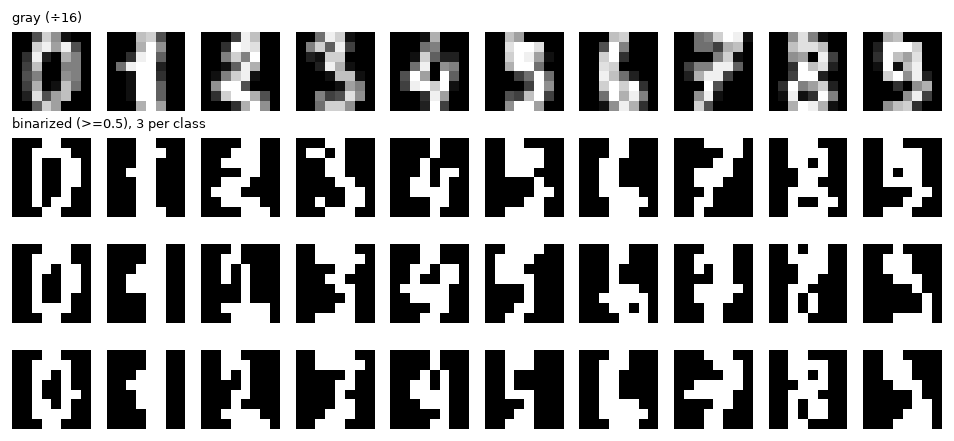

# md2pdf 示例文档

姓名：张三　学号：000000

这是一份用来演示 md2pdf 能力的文档。把它转成 PDF：`node md2pdf.js examples/demo.md`。

## 1. 公式

行内公式：$e^{i\pi}+1=0$，变量 $\mu_j$、$\sigma^2$ 都可以。

独立公式（两个美元符号包住）：

$$D_{\mathrm{KL}}\bigl(\mathcal N(\mu,\sigma^2)\Vert\mathcal N(0,1)\bigr)=\frac12\bigl(\mu^2+\sigma^2-\log\sigma^2-1\bigr)$$

多行对齐：

$$
\begin{aligned}
\log p_\theta(x)&=\mathcal L_{\rm ELBO}+D_{\rm KL}(q_\phi\Vert p_\theta)\\
&\ge\mathcal L_{\rm ELBO}
\end{aligned}
$$

## 2. 表格

| β | 重建 NLL | KL | 标准负 ELBO |
|---|---:|---:|---:|
| 0 | 16.99 | 97.61 | 114.60 |
| 1 | 16.91 | 3.26 | **20.17** |

## 3. 图片



图 1：图片用相对 `.md` 文件的路径引用即可，会被内嵌进 PDF。

## 4. 其他常用写法

- 列表、**加粗**、*斜体*、`行内代码`
- 引用：

> 这是一段引用。

代码块：

```python
def kl(mu, logvar):
    return 0.5 * (mu**2 + logvar.exp() - 1 - logvar).sum(-1)
```

# 第二个一级标题

默认每个一级标题会另起一页（可用 `--no-h1-break` 关掉）。
